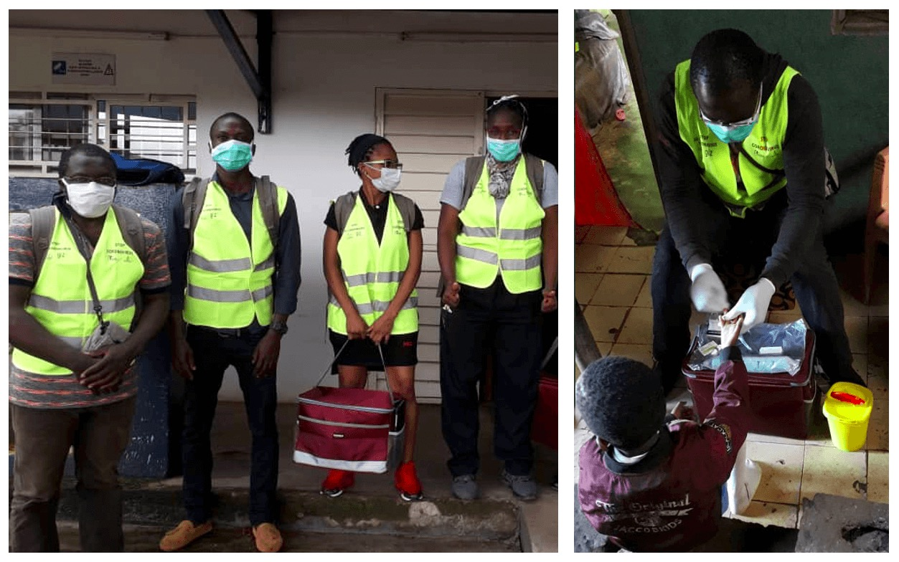
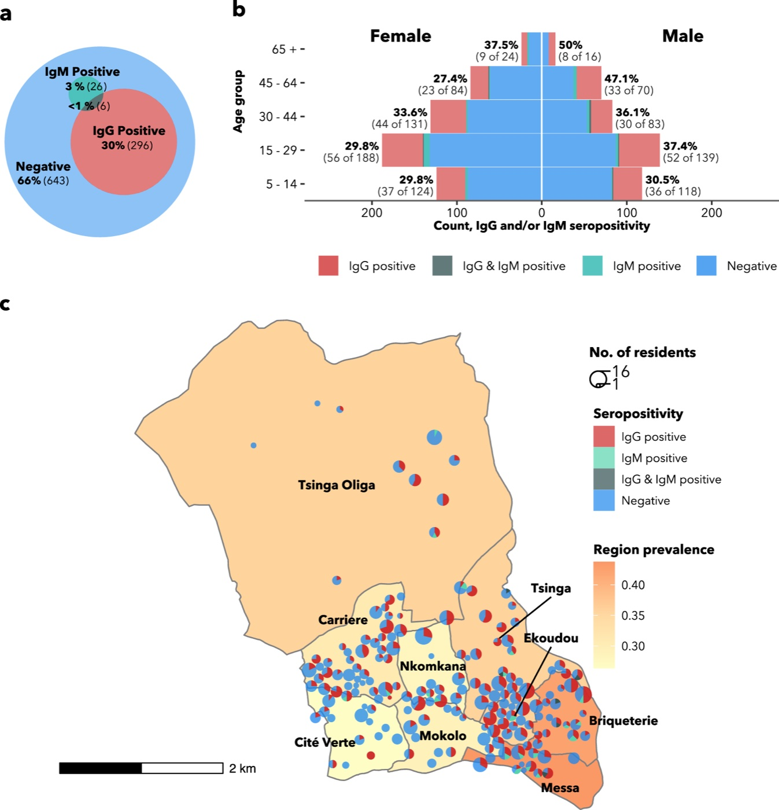

In this small-group exercise, you will prompt an AI agent to reproduce a published figure from the raw data, and then explore ways to improve or redesign it.

Overall learning objectives: 

- Practice guiding an AI agent from raw data to a reproducible visualization
- Practice auditing AI-generated code and figures

The data come from a COVID-19 antibody survey conducted in Yaoundé, Cameroon, in late 2020. The survey estimated how many people in the area had been infected with COVID-19 by testing for IgG and IgM antibodies. IgG antibodies indicate past infection, while IgM antibodies indicate recent infection.

{fig-alt="Left: four survey team members in high-visibility vests and face masks. Right: a team member administering a finger-prick antibody test to a child."}

## Individual work (20 min)

### 1. Select a panel to reproduce

Take a look at the three panels in the Figure below (a, the Euler diagram; b, the age-sex pyramid; c, the area map). 

Then as a group, decide which of the three you would like to reproduce. Your group should pick one you understand well enough to interpret and check. 

Everyone in the group will work on the same panel, but you should all work individually. You will share your results with each otherat the end of the exercise.

::: {.figure-box}
::: {.figure-box-title}
Fig. 1: Crude IgG and IgM seroprevalence
:::

From [Nwosu *et al.*, *Nature Communications*, 2021](https://www.nature.com/articles/s41467-021-25946-0){target="_blank"}.

{fig-alt="Figure 1 from the paper: panel a Euler diagram, panel b age-sex pyramid, panel c neighbourhood map with household pie charts"}

::: {.figure-box-caption}
**a** Euler diagram showing seropositivity of respondents by antibody test. **b** Seropositivity of respondents by antibody type and age-sex stratum. Percentage labels and numbers in parentheses indicate the proportion of each stratum that is IgG and/or IgM seropositive. **c** Household and geographic variation in seropositivity. Choropleth fill colour indicates the neighbourhood seroprevalence (IgG and/or IgM). Pie charts indicate household size, household location and the proportion of the household that is seropositive. Pie charts are dodged and jittered to avoid overlap and to preserve location anonymity. Five households are not shown due to improperly-coded or missing coordinates. IgG Immunoglobulin G, IgM Immunoglobulin M.
:::
:::

### 2. Download the data

Download and unzip the [survey data](https://github.com/kendavidn/uzh_webinar/raw/main/yaounde_covid/short_dataset/yaounde_covid_en.zip). Spend a few minutes browsing it. Each row is one survey participant, with demographic, socio-economic and COVID-related variables. The antibody test results are in the columns `igg_result` and `igm_result`.

If you selected **panel c**, also download the [neighbourhood boundaries](https://github.com/kendavidn/uzh_webinar/raw/main/yaounde_covid/short_dataset/cite_verte_health_areas.zip) needed to plot the map.

::: callout-note
## Safe to share with AI tools

This dataset is public and de-identified, so you can safely share it with any AI tool. We will discuss data privacy and governance considerations for your own research data later in the session.
:::

### 3. Prompt and iterate

Now you will open your AI agent to work on the task.

::: callout-warning
## Which agent to use

- **Use a frontier paid model.** Freely provided models will likely stumble on this task. Your university-provided Copilot will also probably fail. We recommend a paid account on ChatGPT, Claude, Gemini, or Cursor. If you do not have a paid account on any of these, please let an instructor know, and they will grant you access to ChatGPT Plus.
- **Browser recommended.** For this exercise, it is easiest to work in the browser with ChatGPT, Claude, or Gemini. If you already use a coding agent that runs on your own computer (such as Claude Code, Codex, or Cursor), you can use that instead. We will talk about these local agents in the main room.
:::

Once you have selected an agent, copy the suggested prompt template below and paste in the caption for your chosen figure panel (a, b, or c).

```markdown
Using the attached data, create the figure described in the caption below.

Succinctly list any data cleaning or other judgment decisions you made.

Return the figure as a PNG, and provide the code for download.

Do not look up the paper to find relevant code or context.

[PASTE THE CAPTION FOR YOUR CHOSEN PANEL HERE]
```

::: callout-tip
## Why such a short prompt?

We keep the prompt short so it is quick to read and adapt during the exercise. It also lets you see which judgment calls the model makes on its own when you don't spell out exactly what you want. Some of those calls will differ from what the original analysts did.

In your own research, you will likely want to give the model as much context as you can, such as the data dictionary, the study protocol, or the relevant parts of a paper. The more context it has, the fewer guesses it has to make.
:::

Once you have a first draft, compare it against the published panel. Note the differences, and use follow-up prompts to get closer to the published panel. Focus on matching the underlying numbers and structure; exact colours and styling are not too important and do not need to match.

It may be helpful to provide relevant details from the Methods section of [the paper](https://www.nature.com/articles/s41467-021-25946-0){target="_blank"}.


::: callout-important
## Do not upload the published figure

The goal is to simulate the workflow of the original analyst, wherein you have the raw data and an idea of the figure you want to produce, but the figure does not exist yet.
:::

### 4. Improve or redesign the visualization

Once you have a close reproduction of the published panel, think about how you could improve the visualization or show the same data in a different way. 

Prompt the agent to generate your redesigned figure. 

For this step, you may upload screenshots of other figures or visual styles as inspiration to guide the agent.

## Group discussion (Last 10 min of breakout room)

Each person in the group should share their reproduced figure plus their improved or alternative visualization. Discuss some or all of the following:

- What context did the AI need that was missing from the figure caption?
- Did the AI make any data-cleaning or analytical decisions you found questionable or commendable?
- Did you use any prompting techniques or tricks you think are worth sharing with the group?

## Back in the main room

Share your reproduced figure, your improved or alternative visualization, and your chat's **Share** link in the meeting chat.

